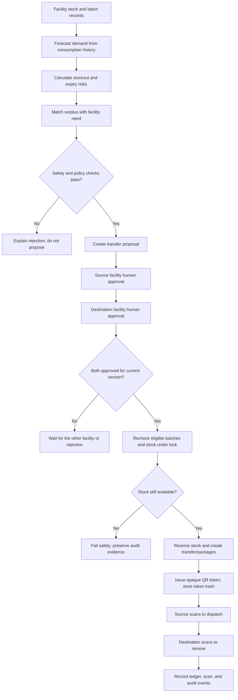
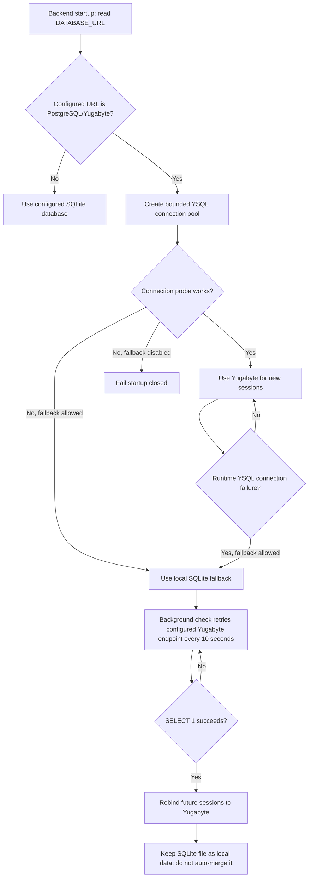

# MediFlow — Complete LLM Context and Demo Guide

> **Purpose:** This document is a project-grounded briefing for an LLM, reviewer, teammate, or demo presenter. It describes the repository as inspected on **1 November 2026**, including the latest chatbot/RAG pull on `main` (`f08e9d0`, “Improved the RAG pipeline”). It distinguishes deterministic business rules from AI-generated explanations and names the important fallbacks.

---

## 1. MediFlow in one minute

**MediFlow is a multi-facility medicine inventory and redistribution prototype.** It helps a healthcare network see stock and expiry risks, forecast demand, identify safe stock-sharing opportunities, request approval from both facilities, reserve stock, and track a transfer using serialized QR labels and an audit trail.

The central product idea is:

> **Use reliable operational data and explainable rules to find a safe action; use AI to make the evidence easier to understand; keep clinical approval and physical custody with people.**

Facilities, products, batches, stock balances, and consumption histories in the demo are synthetic. MediFlow is not a clinical decision system, does not recommend patient treatment, and must not be used to guide real patient care.

---

## 2. The three technology highlights

MediFlow combines **YugabyteDB, MEKO, and Google Gemini** for different jobs. They complement one another; none replaces the safety-critical business rules.

### 2.1 YugabyteDB — operational source of truth

YugabyteDB’s YSQL interface is PostgreSQL-compatible. When available and configured, it is MediFlow’s primary relational database for operational records such as:

- Organisations, facilities, users, and facility memberships
- Products, medicine batches, inventory balances, and consumption
- Forecast runs and risk assessments
- Transfer proposals, batch lines, approvals, transfers, packages, and QR label hashes
- Scan events, workflow runs, audit events, and the inventory movement ledger

The backend uses SQLAlchemy ORM and PostgreSQL’s `psycopg2` driver. The relational database is where the application checks current stock, validates approvals, reserves inventory, and records the transfer lifecycle.

The chatbot also uses YugabyteDB’s **pgvector** extension for project-knowledge retrieval when Yugabyte is the active operational database. The current implementation creates or refreshes the small `mediflow_rag_chunks` knowledge table and uses vector cosine-distance ordering (`<=>`) to find relevant chunks. This is a separate job from reading live inventory.

**Important distinction:** MEKO memories, vector-search chunks, and model-generated text are not authoritative stock records. Current quantities and batch status are read from the active operational database for each chat request.

### 2.2 MEKO — shared operational memory and decision context

MEKO is the decoupled shared-memory integration used by the workflow and assistant to retain and retrieve short, non-patient-specific operational context. For example, the workflow may store a short summary of a completed run and its status. That context can help later operations understand prior coordination.

The adapter:

1. Sends a summary to MEKO’s `/memories` endpoint when credentials are configured.
2. Adds facility/product metadata and a data-pack reference where available.
3. Retrieves memories using a query, facility scope, and result limit.
4. Marks returned records with provenance so the application can tell live MEKO results from local fallback records.
5. Keeps a process-local memory fallback if MEKO is unconfigured or unavailable.
6. Sanitizes metadata keys that look like patient identifiers before storing.

In the chatbot, successful **live MEKO** results have first priority as retrieved project context. If there are no live MEKO results, retrieval proceeds to Yugabyte pgvector or the local knowledge index. A local MEKO fallback is not treated as a live MEKO result by the chat retriever.

**MEKO is not the operational database.** It does not decide whether stock exists, whether a batch is eligible, whether a user may approve, or whether a transfer can be reserved.

### 2.3 Google Gemini — grounded explanation and language understanding

Gemini provides language capabilities around facts that MediFlow has already gathered:

- In the multi-agent workflow, it receives a bounded set of verified inventory, forecast, risk, and matching facts and returns a structured analysis.
- In the chatbot, it can interpret a general operational question and write a concise answer using the live database context and retrieved project chunks.
- For chatbot retrieval, a configured Gemini embedding model can produce 768-dimensional vectors for the question and project knowledge chunks.

The workflow’s requested output is validated against a Pydantic schema, including an operational summary, risk drivers, a non-binding recommended action, uncertainties, missing fields, and a confidence assessment. The prompt prohibits inventing stock, dates, and forecasts.

If Gemini is unavailable, the application labels and uses deterministic template/grounded fallback behavior instead. Some common stock and expiry questions are answered directly from the computed database totals without calling Gemini at all. The response identifies the answer provider so the UI can distinguish a Gemini answer from a grounded fallback.

**Gemini is an explainer, not an authority.** It cannot approve a transfer, reserve stock, adjust inventory, dispatch a package, or receive it.

### The star-role summary

| Technology | MediFlow’s use | What it is not responsible for |
|---|---|---|
| **YugabyteDB** | Primary relational operational data; pgvector project-context retrieval | Writing explanations or approving clinical actions |
| **MEKO** | Shared operational memory, context, and decision summaries | Live stock truth, eligibility, or authorization |
| **Gemini** | Structured reasoning, conversational answers, optional embeddings | Deterministic stock calculations, permissions, or transfer execution |

---

## 3. Project architecture

### 3.1 Technology stack

**Frontend**

- Next.js 14 App Router
- React 18, JavaScript/JSX
- Tailwind CSS
- Recharts for charts
- Lucide React for icons
- `html5-qrcode` for browser QR scanning
- A frontend API client in `Frontend/lib/api.js` calling the versioned FastAPI API

**Backend**

- Python FastAPI and Uvicorn
- Pydantic v2 schemas and validation
- SQLAlchemy 2 ORM
- Alembic migrations
- `psycopg2-binary` for PostgreSQL/YSQL connectivity
- LangGraph and its in-process `MemorySaver` for the bounded specialist workflow
- Google GenAI SDK for Gemini
- HTTPX for MEKO calls
- NumPy/Pandas for numerical and data-processing support

**Storage and verification**

- YugabyteDB YSQL as configured primary operational storage
- Local SQLite as the development fallback and, when Yugabyte is live, a separate local knowledge-index fallback
- Append-only-style inventory movement and audit records used to explain operational changes
- Pytest backend tests and a Next.js production build for frontend validation

### 3.2 Repository map

```text
MediFlow/
├── Frontend/
│   ├── app/                         # Dashboard shell and Next.js app
│   ├── components/                  # Navigation and feature views
│   │   └── views/ChatView.jsx       # Ask MediFlow chat UI
│   ├── hooks/useApiHealth.js        # API/database health polling
│   └── lib/api.js                   # Browser-to-FastAPI requests
├── Backend/
│   ├── app/api/routes/              # Versioned HTTP API routes
│   ├── app/agents/                  # LangGraph state, graph, deterministic tools
│   ├── app/core/                    # Settings, DB engine, failover/failback, security
│   ├── app/integrations/            # Gemini and MEKO adapters
│   ├── app/models/                  # SQLAlchemy entities
│   ├── app/schemas/                 # API and structured model-output schemas
│   ├── app/services/                # Forecasting, matching, approvals, chat, QR, etc.
│   ├── alembic/versions/            # Database schema migrations
│   └── tests/                       # Backend tests
├── data/                            # Synthetic seed data
├── docs/                            # Additional project documentation
├── infra/                           # Local/container infrastructure
├── scripts/                         # Development launch scripts
├── README.md
└── LLM_CONTEXT.md                  # This project briefing and demo guide
```

### 3.3 Main application data

The data model connects an organisation to its facilities and users; products to manufacturer batches; and batches to per-facility inventory balances. Consumption history supports forecasts. Forecast and risk outputs support matching. Proposals contain one or more batch lines, approvals record each facility’s decision, and a reserved proposal creates a transfer with packages and serialized labels. QR scans and audit/ledger events record custody and stock movements.

Key tables include `organisations`, `facilities`, `users`, `facility_memberships`, `products`, `batches`, `facility_batch_inventory`, `consumption_records`, `forecast_runs`, `risk_assessments`, `transfer_proposals`, `transfer_proposal_batches`, `transfer_approvals`, `transfers`, `transfer_packages`, `serialized_labels`, `scan_events`, `inventory_ledger`, `audit_events`, and `agent_workflow_runs`.

---

## 4. End-to-end operational pipeline



### 4.1 Deterministic planning

1. **Forecast:** Demand is estimated from facility/product consumption history using a deterministic weighted moving-average baseline. The result includes projected demand, a confidence/data-quality signal, and warnings.
2. **Risk:** Rules identify conditions such as low days of cover and batches at expiry risk. Batch/quality facts and data freshness can affect eligibility.
3. **Matching:** The matching service considers a source with protected surplus and a destination with unmet need. It checks product transfer policy, source safety stock, batch shelf life, and destination storage capability (including cold-chain compatibility). It returns accepted opportunities and structured rejection reasons.
4. **Proposal:** A match is a recommendation, not a transfer. Creating a proposal persists the proposed quantities and selected batch lines. This step by itself does not reserve stock.
5. **Approval:** A user must be active, authorized for the approver role, and associated with the relevant facility or its organisation. The source and destination decisions must match the proposal’s current version.
6. **Reservation:** After both approvals, the backend revalidates the batch and quantity under row locks and records stock movements in the same operational transaction. A conflict fails safely rather than reserving unavailable stock.
7. **Custody:** Transfer packages and hashed opaque label tokens support dispatch and receipt scans. Scan type, facility boundary, duplicate/idempotency checks, expected state, and received quantities are validated before posting corresponding ledger/audit records.

### 4.2 Approval and transfer safety

- The interface’s persona selector is for this prototype/demo; it is not a production identity provider.
- Authorization is still checked by the backend; choosing a persona in the UI is not a substitute for server-side checks.
- Approval is per facility and proposal version. Stale approvals are rejected.
- Both facilities must approve before reservation.
- Reservation rechecks stock and batch eligibility. Matching results are not blindly trusted later.
- Transfer state transitions are constrained by a state machine; callers cannot skip required steps.
- QR tokens are opaque; the database stores a token hash. Scans are checked for allowed status, facility boundary, expected transfer, duplicates, and reconciliation conditions.
- Rejections, state changes, reservations, and custody events are recorded to audit/ledger data.
- The UI’s “stock shock” scenario is a demonstration of safe failure when stock changes after a match.

---

## 5. LangGraph multi-agent system

### 5.1 What “agent” means in MediFlow

The workflow is a bounded **LangGraph StateGraph** with specialist nodes and a network coordinator. Each specialist gathers facts or calls deterministic MediFlow services through named tools. This is not a collection of unconstrained LLMs independently changing inventory.

The LangGraph state carries facility/product scope, inventory/data-quality observations, forecast and risk results, candidate matches, policy outcomes, MEKO context, Gemini analysis/status, proposal and approval references, node traces, and workflow status.

```mermaid
flowchart LR
    A[Start: manual workflow request] --> B[1. Inventory Monitoring Agent]
    B --> C[2. Demand Forecast Agent]
    C --> D[3. Expiry and Risk Agent]
    D --> E[4. Supply Optimisation Agent]
    E --> F[5. Network Coordinator]
    F --> G[Retrieve MEKO context]
    G --> H[Gemini structured synthesis]
    H --> I[Deterministic proposal policy validation]
    I --> J{Valid candidate?}
    J -- No --> K[Complete with no proposal or policy rejection]
    J -- Yes --> L[Create proposal; pause for human approval]
    L --> M[Source and destination approve]
    M --> N[Revalidate and reserve stock]
```



The five workflow participants are:

1. **Inventory Monitoring Agent**
   - Calls `get_facility_inventory`.
   - Summarizes relevant lot records and flags freshness, missing quantity, and near-expiry issues.
   - Records a structured observation and node trace.

2. **Demand Forecast Agent**
   - When scoped to a facility and product, calls `get_consumption_history` and `run_demand_forecast`.
   - The numerical forecast is calculated by MediFlow’s deterministic forecasting service, not invented by Gemini.
   - Carries forecast warnings and missing-history uncertainty into the workflow state.

3. **Expiry and Risk Agent**
   - Calls `calculate_stockout_risk` and `calculate_expiry_risk`.
   - Records risk counts, severity flags, and a traceable observation.
   - It reports operational risk signals; it does not make clinical treatment decisions.

4. **Supply Optimisation Agent**
   - Calls `find_candidate_facilities` and inspects accepted/rejected matches.
   - For its leading candidate, calls `calculate_transfer_options` to calculate a feasible amount and FEFO batch allocation.
   - Produces a recommendation only; it does not reserve stock.

5. **Network Coordinator / Orchestrator**
   - Retrieves relevant MEKO context.
   - Sends a bounded fact package, uncertainties, and data-quality flags to Gemini for structured synthesis.
   - Calls deterministic `validate_transfer_proposal` before `create_transfer_proposal`.
   - Marks the workflow as paused for human approval if a valid proposal is created.
   - Stores a concise workflow summary back through the MEKO adapter and captures a node trace.

### 5.2 Workflow tools

The bounded tool library includes:

1. `get_facility_inventory`
2. `get_consumption_history`
3. `run_demand_forecast`
4. `calculate_expiry_risk`
5. `calculate_stockout_risk`
6. `find_candidate_facilities`
7. `calculate_transfer_options`
8. `validate_transfer_proposal`
9. `create_transfer_proposal`
10. `get_approval_status`
11. `get_transfer_status`

These are application functions over the supplied SQLAlchemy session and domain services. Tool results are structured data, not free-form authority.

### 5.3 Gemini’s exact workflow role

Gemini receives a selected structured summary, such as data quality, forecast, risk counts, and a candidate match. It produces explanation fields—not stock movements. Its output is parsed and validated against `GeminiStructuredAnalysis`. If the call/key is unavailable or output cannot be used, a clearly labeled deterministic template fallback is returned.

**The deterministic validator and human approval remain the gates.** Gemini text cannot create a valid transfer on its own.

### 5.4 Workflow persistence and review

Each run is assigned a workflow ID. `AgentWorkflowRun` stores its status, scopes, proposal link, summaries, agent observations, Gemini/MEKO status, tool/node traces, and exceptions. The workflow API exposes a list and a detailed trace for inspection.

The workflow can return a paused-for-approval state. The resume operation checks the recorded approvals for the relevant proposal/version, performs deterministic policy and stock revalidation, and then reserves if still safe. The regular transfer-approval route also enforces two-party approval and safe reservation.

---

## 6. Ask MediFlow chatbot and full RAG pipeline

### 6.1 What the assistant can do

The **Ask MediFlow** assistant answers operational questions about medicines, current stock, batches and expiry, facilities, risks, forecasts, transfers, and how the product works. It is available as a dedicated sidebar page and as a floating assistant panel from other dashboard pages.

It does not approve proposals, reserve or adjust stock, dispatch/receive transfers, or provide patient-specific diagnosis, treatment, or dosage advice.

### 6.2 Full request pipeline

```mermaid
sequenceDiagram
    participant U as User
    participant UI as ChatView (Next.js)
    participant API as FastAPI /api/v1/chat
    participant RAG as Chat retrieval service
    participant M as MEKO shared memory
    participant Y as YugabyteDB / pgvector
    participant L as Local SQLite knowledge index
    participant O as Operational database
    participant G as Gemini

    U->>UI: Ask question in facility context
    UI->>API: question + facility_id + recent history
    API->>RAG: Validate and answer_chat(...)
    RAG->>RAG: Sanitize input; add prior user turns to retrieval query
    RAG->>M: Search live shared memory first
    alt Live MEKO results
        M-->>RAG: Relevant MEKO summaries + provenance
    else No live MEKO context
        RAG->>Y: Embed question/chunks; pgvector cosine search
        alt Yugabyte retrieval yields chunks
            Y-->>RAG: Top matching project knowledge chunks
        else Unavailable/empty
            RAG->>L: Keyword-ranked local knowledge search
            L-->>RAG: Best local project chunks
        end
    end
    RAG->>O: Resolve medicine/facility; read live batch and stock rows
    O-->>RAG: Current operational records
    RAG->>RAG: Calculate usable, eligible, and expired quantities
    alt Common stock/expiry question has a safe concise answer
        RAG-->>API: Deterministic answer from current DB totals
    else General operational question
        RAG->>G: Grounded prompt + live facts + retrieved chunks + sanitized history
        G-->>RAG: Concise grounded natural-language answer
        Note over RAG,G: If unavailable, use labeled grounded deterministic fallback
    end
    RAG-->>API: Answer + source labels + suggestions + provider metadata
    API-->>UI: Validated ChatResponse
    UI-->>U: Answer, sources, provider label, and follow-up suggestions
```

### 6.3 Retrieval precedence and what each source contains

The chat service selects retrieved **project/context chunks** in this order:

1. **Live MEKO shared memory**
   - Query text and selected facility scope are passed to MEKO.
   - Only records marked with live MEKO provenance and containing a summary are accepted as MEKO chat context.
2. **YugabyteDB pgvector**
   - Used when Yugabyte is active and MEKO did not return live usable context.
   - The service embeds the question plus the curated MediFlow knowledge chunks.
   - Gemini embeddings are used when configured and valid; otherwise a local 768-dimensional feature-hash embedding is used.
   - Embeddings are stored with a model identifier; retrieval filters to the same embedding model and sorts by vector cosine distance.
3. **Local SQLite knowledge index**
   - Used when MEKO does not supply usable live context and Yugabyte vector retrieval is unavailable or empty.
   - Uses token-overlap/term-frequency ranking over curated MediFlow knowledge chunks (not pgvector).

The curated knowledge topics include inventory calculations, FEFO/expiry, forecasting and risk, redistribution constraints, human approvals and QR tracking, data sources, and assistant scope/privacy.

### 6.4 Live facts are retrieved separately

After retrieving context, the chatbot reads the current operational records through the request’s active SQLAlchemy session. It matches likely medicine names/codes and facility names, then reads matching inventory, batches, products, and facilities.

The answer context distinguishes:

- **On hand:** recorded quantity before deductions.
- **Ledger-usable:** `on_hand - reserved - quarantined - damaged`, floored at zero.
- **Eligible non-expired stock:** usable stock only for released, non-expired batches.
- **Expired on-hand:** quantity recorded on expired batches.

A question that explicitly asks for “eligible” or “usable” stock receives the eligible count. A plain stock question reports on-hand and eligible figures. Questions about expired stock use the expiry calculation. If product matching is uncertain, the assistant asks the user to name a medicine instead of inventing one.

These quantities are not read from MEKO, chat history, or knowledge chunks. They are read from the active database at request time, which is Yugabyte when active and may be SQLite when configured for/fallen back to local development storage.

### 6.5 Gemini answer versus deterministic answer

- For common live stock and expiry questions, code builds a short answer directly from the database totals and marks the answer provider as `grounded_fallback`; Gemini is not required for the arithmetic.
- For broader operational questions, the configured Gemini model can turn live facts and retrieved knowledge into a concise answer.
- The Gemini prompt instructs the model to treat live database facts as authoritative for quantities, never invent facts, avoid unrelated data, not execute actions, avoid patient-care guidance, and cite retrieved knowledge chunks.
- If Gemini is not configured, errors, or times out, a grounded deterministic fallback is used and the provider label makes this visible.

The API response includes answer text, source titles, retrieval provider (`meko`, `yugabyte_pgvector`, or `local_sqlite`), answer provider (`gemini` or `grounded_fallback`), follow-up suggestions, and generation time.

### 6.6 Chat privacy and limits

- The frontend sends the current question, active facility ID, and a limited recent conversation history.
- The server schema limits each question/turn to 2,000 characters and history to at most eight turns; the UI sends a shorter recent window.
- The service sanitizes likely email addresses, patient/MRN/SSN-style identifiers, and phone numbers before using question/history text in retrieval/model prompts.
- The chat endpoint does not persist the transcript as a conversation record; chat messages remain in browser state.
- Do not enter patient identifiers or other sensitive personal data.

### 6.7 What the latest chatbot pull improved

The latest pulled commit on `main` at inspection was:

- `d6f69d1` — **Implemented completed RAG based chatbot**
- `f08e9d0` — **Improved the RAG pipeline** (latest inspected `HEAD`)

The RAG improvement strengthened product resolution by removing generic words such as “medicine,” “stock,” and “facility” from product search terms, scoring candidate products by meaningful token overlap, and keeping only the best-matching medicine candidates. It also distinguishes expired-stock questions from eligible/non-expired stock questions, produces concise deterministic answers for live stock/expiry questions, and offers context-aware follow-up suggestions.

It further tightened answer instructions to avoid unrelated medicines, excessive database dumps, and unnecessary metrics. Tests cover live stock grounding, expired stock, facility selection, ambiguity, and deterministic fallback behavior.

---

## 7. Yugabyte connectivity, SQLite fallback, and failback

The configured connection flow is:



Key operational points:

- The supplied settings limit a process to a small bounded pool: up to two pooled connections plus one overflow connection. Total connections scale by process count and replica count.
- In development, a YSQL startup/runtime connection failure can switch future sessions in that backend process to local SQLite.
- The request that encountered a database error is not automatically replayed; retrying a write could duplicate an operation.
- On the current branch, the backend has an automatic Yugabyte recovery monitor. While SQLite is active, it probes the configured Yugabyte endpoint about every ten seconds and switches **future sessions** only after a `SELECT 1` succeeds.
- This failback does **not** copy or merge data written to SQLite into Yugabyte. The SQLite database remains local and may contain changes that are not in Yugabyte.
- In production, SQLite fallback is disabled by default; the backend fails closed unless configuration explicitly allows fallback.
- Health output distinguishes the configured database from the active database and exposes whether the active connection is a fallback.
- Demo reset is prohibited on Yugabyte to protect operational records. Treat any reset action as destructive to local synthetic data.

For a demo, verify health before beginning. If it says SQLite fallback, do not assume the visible data matches Yugabyte. If it says PostgreSQL/Yugabyte and `CONNECTED`, use the current Yugabyte-backed context.

---

## 8. Feature guide and user journey

The frontend is a dashboard with a collapsible navigation sidebar, facility and user persona selectors, backend/database health indicator, and demo controls. The main operational pages are:

| Page | Purpose |
|---|---|
| **Home** | Network summary, low-stock alerts, safe matches, and supply-check action |
| **Facilities** | View participating hospitals, pharmacies, and other locations |
| **Inventory** | Inspect batch-level inventory; perform supported adjustments/import workflows |
| **Risks** | Review stockout and expiry alerts with supporting evidence |
| **Matches** | Review accepted stock-sharing options and rejected candidates/reasons |
| **Approvals** | Record source and destination approval or rejection |
| **Transfers** | View transfer status, packages, and serialized QR labels |
| **QR scanner** | Scan a label for dispatch or receipt and enter reconciliation quantities |
| **Forecasts** | Explore deterministic demand forecasts and projected inventory |
| **Data quality** | Review inventory ingestion and data quality |
| **Workflows** | Start a LangGraph cycle and inspect specialist observations/traces |
| **Audit log** | Review recorded operational activity |
| **Ask MediFlow** | Ask grounded questions about live inventory and project operations |
| **Settings** | Switch demo facility/user persona and use supported demo tools |

The main operational journey is **Home → Matches → Create proposal → Approvals → Transfers → QR scan → Audit log**. Chat and workflow traces can be used to explain why an operational result was produced.

---

## 9. API map

All application endpoints are mounted under `/api/v1`; OpenAPI documentation is available at `/docs`.

| Route family | Example endpoints | Purpose |
|---|---|---|
| Health | `GET /api/v1/health` | Service and active/configured DB status |
| Facilities/products | `/facilities`, `/products` | Network catalogue and product details |
| Inventory | `/inventory` and related routes | Stock views, ledger, adjustments, imports |
| Forecasts/risks | `/forecasts`, `/risks` | Deterministic projections and alerts |
| Proposals | `GET /proposals/opportunities`, `POST /proposals` | Discover matches and create a proposal |
| Approvals | `POST /approvals/{proposal_id}` | Record human facility decision |
| Transfers | `/transfers` | Transfer status, cancellation, lifecycle updates |
| QR | `/qr/scan`, `/qr/transfers/{id}/generate-labels` | Serialized labels and custody scans |
| Agent workflow | `/agent/run-cycle`, `/agent/runs`, `/agent/resume/{workflow_id}` | Run, inspect, and resume workflow |
| Agent status/traces | `/agent/status`, `/agent/traces` | Integration status and MEKO-backed context/traces |
| Chatbot | `POST /chat` | Grounded operational Q&A |
| Demo | `/demo/context`, `/demo/reset` | Synthetic context and guarded demo reset |
| Audit | `/audit/events` | Audit history |

---

## 10. Four-minute demo video: presenter runbook

### 10.1 Before recording

1. Start the backend and frontend using the repository’s normal launch scripts.
2. Open `http://localhost:3000`; confirm the dashboard has loaded.
3. Click/check the health indicator and confirm the API is online. If showing database status, say exactly what it reports: YugabyteDB or SQLite fallback.
4. Confirm the synthetic demo data has useful risk alerts, at least one match, and a proposal path available. Do this before recording.
5. Do **not** press “Reset demo” against a live Yugabyte database; the backend intentionally blocks destructive demo resets there. If a reset is needed, use an approved local synthetic database only.
6. Choose a facility persona and active user with an appropriate approval role. For the second approval, switch to the other facility and its authorized demo user.
7. If Gemini or MEKO is offline, the prototype has deterministic/local fallback paths. Describe the displayed mode honestly; do not claim a live call occurred if its status indicates fallback.
8. Keep patient-identifiable information out of the recording and chat prompts.

### 10.2 Timed narrative (about 3:45)

#### 0:00–0:25 — Introduce the problem and product

**Show:** Home dashboard.

**Say:**
“Hospitals can have medicine shortages while nearby facilities have safe surplus. MediFlow brings inventory, demand, risk, and transfer approvals into one place. The goal is simple: make safe sharing easier to see and easier to verify.”

#### 0:25–0:55 — Show operational overview

**Show:** Summary cards, low-stock alerts, safe stock matches.

**Say:**
“This overview summarizes participating facilities, monitored medicines, shortage and expiry alerts, available-to-share stock, and completed transfers. The numbers are grounded in the application’s operational data.”

#### 0:55–1:30 — Highlight the agent workflow and AI roles

**Show:** Click **Run supply check**. Open the **Workflows** page and inspect the resulting run/trace if time permits.

**Say:**
“The workflow runs five bounded specialists: inventory monitoring, demand forecasting, expiry and risk review, supply optimization, and a network coordinator. The first four gather and calculate evidence with deterministic MediFlow services. The coordinator retrieves shared context from MEKO and asks Gemini to explain the verified facts. YugabyteDB stores the operational records. The AI can explain a proposal, but it cannot approve or reserve medicine.”

#### 1:30–2:00 — Find a safe match and create a proposal

**Show:** Open **Matches**, select an eligible candidate, and click **Create request**.

**Say:**
“A match is a recommendation, not an automatic transfer. MediFlow checks the source surplus, destination need, medicine policy, batch shelf life, and storage requirements. Creating this request records a proposal; it does not move stock.”

#### 2:00–2:40 — Demonstrate two-facility approval

**Show:** On **Approvals**, authorize once as the source facility; switch the active facility/persona to the destination and authorize again.

**Say:**
“Both sides have to review the same proposal version. The backend checks that each user is active and authorized for that facility. Only after both approvals does it lock and recheck the stock before reservation.”

#### 2:40–3:10 — Follow the transfer and QR handoff

**Show:** Open **Transfers**, show its status and QR package. If the demo scanner and a working label are available, scan at dispatch and then receipt; otherwise show the UI/label and explain the sequence without pretending a scan occurred.

**Say:**
“The reserved transfer gets package-level serialized QR labels. A dispatch scan and a receiving scan update the custody record. The system checks the label, transfer state, and facility boundary, then records movements and audit events.”

#### 3:10–3:40 — Show Ask MediFlow and its grounding

**Show:** Open **Ask MediFlow** and ask:
**“How much [medicine visible in this demo] stock is at [facility visible in this demo]?”**

Then show the answer’s source/provider label.

**Say:**
“The assistant combines retrieved context with a fresh query to the operational database. MEKO can supply relevant shared memory; Yugabyte pgvector can retrieve project knowledge; the local knowledge index is a fallback. Current stock is read from the active operational database—not from old memory. Gemini writes grounded explanations when appropriate, and common quantity answers can be calculated directly.”

#### 3:40–3:55 — Close

**Show:** Return to Home or leave the answer and source badge visible.

**Say:**
“MediFlow connects explainable supply planning with human approval and verifiable handoff. MEKO adds shared context, Gemini makes evidence easier to understand, and YugabyteDB holds the operational record. The final decision and physical custody stay governed by the workflow and people.”

### 10.3 If time is tight

Prioritize **Home → Match → Proposal → Two approvals → Transfer/QR → Ask MediFlow**. Mention the agent trace and data platform roles verbally if you cannot show their screens. Do not start a slow live workflow call during the take unless you have tested its timing beforehand.

---

## 11. Short presentation-ready project summary

> “MediFlow is an explainable medicine redistribution platform for healthcare networks. It combines batch-level inventory, deterministic demand forecasts, expiry and shortage alerts, safety-checked surplus matching, dual-facility human approval, atomic stock reservation, and QR-based transfer tracking. YugabyteDB stores the operational truth, MEKO supplies shared operational context, and Google Gemini turns verified evidence into structured explanations and conversational answers. A bounded LangGraph workflow coordinates specialist analysis, while deterministic policy checks and human approvals control every transfer.”

---

## 12. Important boundaries and facts for future LLMs

- Treat **current database rows** as the source of truth for live stock, approvals, batches, and transfer status.
- Do not claim that MEKO contains current stock or is the source of truth.
- Do not claim Gemini computes the authoritative forecast or determines authorization.
- Do not claim a proposed match has already moved stock.
- A proposal is not a reservation; both facilities must approve before the backend revalidates and reserves.
- The displayed database may be Yugabyte or SQLite. Read `/api/v1/health` and report the active engine accurately.
- A SQLite fallback is a separate local store; automatic failback does not merge fallback writes into Yugabyte.
- Gemini/MEKO can be unavailable; use the status and provider labels rather than claiming live execution.
- Chat history is browser-session state, not persistent server conversation storage.
- Chat answers are operational only. Never advise patient-specific diagnosis, treatment, or dosage.
- Demo identities/data are synthetic personas, not a production identity provider or real patients.
- Never include secrets, keys, private database URLs, or patient data in LLM context or demo narration.

---

## 13. Source files for implementation details

| Concern | Main source files |
|---|---|
| Dashboard and chat entry point | `Frontend/app/page.jsx`, `Frontend/components/Sidebar.jsx` |
| Chat display and API call | `Frontend/components/views/ChatView.jsx`, `Frontend/lib/api.js` |
| Chat request/response | `Backend/app/api/routes/chat.py`, `Backend/app/schemas/chat.py` |
| RAG and live inventory context | `Backend/app/services/chat_service.py` |
| LangGraph workflow definition/state/tools | `Backend/app/agents/graph.py`, `Backend/app/agents/state.py`, `Backend/app/agents/tools.py` |
| Workflow run persistence and approval resume | `Backend/app/services/agent_service.py`, `Backend/app/api/routes/agent.py` |
| Gemini adapter | `Backend/app/integrations/gemini.py` |
| MEKO adapter | `Backend/app/integrations/meko.py` |
| Database settings, pooling, failover/failback | `Backend/app/core/config.py`, `Backend/app/core/database.py`, `Backend/app/main.py` |
| Transfer approval and reservation | `Backend/app/services/transfer_service.py`, `Backend/app/api/routes/approvals.py` |
| QR label and scan lifecycle | `Backend/app/services/qr_service.py`, `Backend/app/api/routes/qr.py` |
| Forecasts, matching, and risks | `Backend/app/services/forecast_service.py`, `Backend/app/services/matching_service.py`, `Backend/app/services/risk_service.py` |
| Tests | `Backend/tests/test_chat_service.py`, `Backend/tests/test_agent_workflow.py`, and the other `Backend/tests/` modules |
