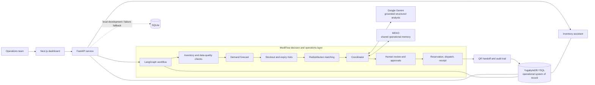
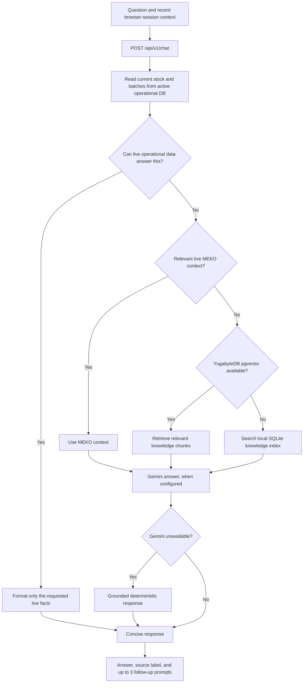
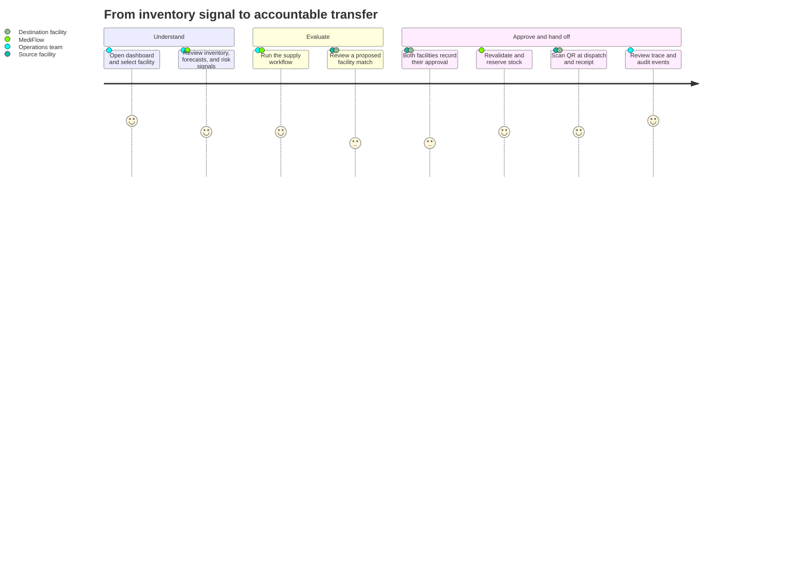

# MediFlow

<p align="center">
  <strong>Medicine supply, made clear.</strong><br />
  Inventory intelligence and human-led redistribution for multi-facility healthcare networks.
</p>

<p align="center">
  <a href="https://github.com/tanmay-joshi-official/MediFlow"></a>
  
  
  
  
  
  
</p>

MediFlow is a prototype for coordinating medicine inventory across healthcare facilities. It brings stock visibility, consumption-based forecasts, expiry and stockout risk signals, redistribution recommendations, human approvals, and transfer traceability into one operational workflow.

> **Prototype notice:** Demo facilities, products, balances, lots, and consumption histories may be synthetic. MediFlow is not a clinical decision system. Do not use it to make patient-care decisions or handle real patient data.

## At a glance

- Inspect inventory at facility and batch level.
- Forecast demand from historical consumption using deterministic weighted moving-average logic.
- Flag potential stockout, expiry, and data-quality risks.
- Identify possible surplus-to-need matches across facilities.
- Require source- and destination-side human approval before reservation.
- Track dispatch and receipt with QR-supported handoffs and auditable events.
- Ask inventory questions in natural language using the assistant.

## The platform, in one view



### Technology roles

| Technology | Role in MediFlow |
|---|---|
| **YugabyteDB YSQL** | PostgreSQL-compatible operational database and system of record for facilities, products, batches, inventory, forecasts, risks, proposals, approvals, transfers, and audit/workflow records. The assistant reads live stock and batch facts from the active operational database. |
| **Google Gemini** | Optional reasoning and language layer. In the multi-agent workflow, it receives verified tool outputs and returns schema-validated analysis. In the assistant, it can create a concise response grounded in live inventory facts and retrieved context. It does not calculate authoritative stock balances or approve a transfer. |
| **MEKO** | Optional shared operational memory and decision-trace service. It provides contextual planning notes to the coordinator and assistant; it is not authoritative for current inventory, permissions, approvals, or transfer eligibility. |
| **LangGraph** | Runs the bounded, sequential specialist workflow and carries state and traces between stages. The stages use deterministic business tools for inventory, risk, and matching calculations. |
| **SQLite** | Local development/test database and configured development fallback when YSQL is unavailable. It is not automatically synchronized back to YugabyteDB. |
| **Next.js and FastAPI** | Dashboard and HTTP API. The browser talks to FastAPI; database access and external AI/memory calls remain server-side. |

### Assistant retrieval and answer path

The assistant keeps **live operational facts separate from explanatory retrieval**. Questions about stock, lot quantities, and expiry are answered directly from the operational database. Project and policy questions use available shared context and knowledge retrieval.



- Current inventory and expiry facts always come from live operational records, not memory or static knowledge chunks.
- For knowledge retrieval, the preferred sequence is live MEKO context, YugabyteDB pgvector, then the local SQLite knowledge index.
- Gemini embeddings are used for pgvector retrieval when configured; a local feature-hash embedding is available as a fallback.
- Without Gemini, the assistant uses deterministic, fact-grounded response templates.
- Chat history is held in the browser session and sent with requests as limited conversational context. The API does not persist transcripts.
- Do not submit patient identifiers or other sensitive personal information.

## Multi-agent workflow

The workflow is a five-stage LangGraph pipeline. “Agent” describes a bounded specialist stage: stock, risk, forecast, and match calculations are produced by deterministic tools; Gemini supports the coordinator’s explanation when configured.

```mermaid
flowchart LR
    START([Run supply check]) --> A1[1. Inventory Monitoring<br/>balances and data quality]
    A1 --> A2[2. Demand Forecast<br/>consumption history and WMA]
    A2 --> A3[3. Expiry and Risk<br/>stockout and batch expiry]
    A3 --> A4[4. Supply Optimisation<br/>surplus-to-need candidates]
    A4 --> A5[5. Orchestrator<br/>MEKO context + Gemini analysis]
    A5 --> VALIDATE[Deterministic policy revalidation]
    VALIDATE -->|No viable proposal| DONE([Record outcome])
    VALIDATE -->|Proposal passes| HUMAN[Pause for human approval]
    HUMAN -->|Source and destination approve| RECHECK[Recheck policy and available stock]
    RECHECK -->|Still valid| RESERVE[Reserve and track transfer]
    RECHECK -->|No longer valid| STOP([Do not reserve])
    RESERVE --> DONE
```



1. **Inventory Monitoring** inspects balances, reporting freshness, missing quantities, and near-expiry data.
2. **Demand Forecast** reads consumption history and computes a weighted moving-average demand forecast.
3. **Expiry and Risk** evaluates stockout and expiry risk using operational data and deterministic rules.
4. **Supply Optimisation** identifies potential source/destination facilities and computes feasible transfer options.
5. **Orchestrator / Network Coordinator** retrieves MEKO context, requests grounded structured analysis from Gemini, validates transfer policy, and creates a proposal when appropriate.

The workflow does not autonomously move medicine. A proposal pauses for human review; both facilities must approve. Before reservation, MediFlow revalidates policy and stock to account for changes since the proposal was created.

## User journey



## User-facing features

- **Network overview:** summary cards and operational attention areas.
- **Inventory:** facility, medicine, and batch-level quantities and status.
- **Forecasts and risks:** deterministic demand projections, stockout signals, and expiry review.
- **Matches and approvals:** candidate redistribution opportunities and explicit human approval steps.
- **Transfers:** status tracking, QR-supported dispatch and receipt, and audit history.
- **Ask MediFlow:** natural-language inventory assistant with live operational answers and cited source labels.
- **Data quality and workflows:** data-quality checks and agent-run observations/traces.

## Repository layout

```text
MediFlow/
├── Backend/
│   ├── app/
│   │   ├── agents/          # LangGraph state, specialist stages, and deterministic tools
│   │   ├── api/routes/      # FastAPI route handlers (/api/v1 and /api)
│   │   ├── core/            # Settings, database lifecycle, and security
│   │   ├── integrations/    # Gemini and MEKO adapters
│   │   ├── models/          # SQLAlchemy data models
│   │   ├── schemas/         # Pydantic request/response contracts
│   │   └── services/        # Inventory, forecasting, transfer, and chat services
│   ├── alembic/             # Database migration configuration
│   ├── tests/               # Backend test suite
│   ├── .env.example
│   └── requirements.txt
├── Frontend/
│   ├── app/
│   │   ├── page.jsx         # Public landing page
│   │   └── dashboard/       # MediFlow operations dashboard
│   ├── components/          # Dashboard, chat, and landing-page UI
│   ├── hooks/               # Client-side hooks
│   ├── lib/                 # API client
│   └── .env.example
├── data/                    # Seed data and fixtures
├── docs/                    # Architecture and project documentation
├── infra/                   # Docker and Compose configuration
├── scripts/                 # Development and run helpers
├── .env.example
└── README.md
```

## Get started

### Requirements

- Python 3.10 or later (Python 3.12 is supported by the project setup)
- Node.js 18 or later
- npm
- Optional: a PostgreSQL-compatible YugabyteDB YSQL URL, Gemini API key, and MEKO API key

### 1. Configure the backend

From the repository root:

```bash
cd Backend
python -m venv .venv
```

Activate the environment:

```powershell
# Windows PowerShell
.\.venv\Scripts\Activate.ps1
```

```bash
# macOS / Linux
source .venv/bin/activate
```

Install backend dependencies and configure environment:

```bash
pip install -r requirements.txt
copy .env.example .env
```

On macOS/Linux, use `cp .env.example .env` instead of `copy`.

The default `DATABASE_URL` uses local SQLite. For YugabyteDB YSQL, configure a PostgreSQL-compatible DSN in `.env`, for example:

```dotenv
DATABASE_URL=postgresql://<username>:<password>@<host>:5433/<database>?sslmode=require
```

Use the database name and TLS options provided for your cluster. URL-encode special characters in credentials. Never commit `.env` files or paste production credentials into issues.

### 2. Configure the frontend

In another terminal:

```bash
cd Frontend
npm install
```

Copy the environment template:

```powershell
# Windows PowerShell
copy .env.example .env.local
```

```bash
# macOS / Linux
cp .env.example .env.local
```

By default, the frontend API URL points to `http://127.0.0.1:8000`.

### 3. Start the services

Backend, from the `Backend` directory:

```bash
python run.py
```

Or start FastAPI directly:

```bash
uvicorn app.main:app --reload
```

Frontend, from the `Frontend` directory:

```bash
npm run dev
```

Open:

- Landing page: `http://localhost:3000`
- Dashboard: `http://localhost:3000/dashboard`
- API health: `http://127.0.0.1:8000/api/v1/health`
- Interactive API docs: `http://127.0.0.1:8000/docs`

There is no login or signup flow. “Get started” opens the dashboard.

### Docker Compose

The provided Compose setup starts a local SQLite-backed development backend and the frontend:

```bash
docker compose -f infra/docker-compose.yml up --build
```

## Configuration

The root `.env.example` and `Backend/.env.example` provide the full backend configuration template. The most relevant settings are:

| Variable | Purpose | Default |
|---|---|---|
| `DATABASE_URL` | Operational database connection | `sqlite:///./mediflow.db` |
| `DB_POOL_SIZE` | Persistent YSQL pool size per backend process; capped at 2 | `2` |
| `DB_MAX_OVERFLOW` | Temporary overflow connections per process; capped at 1 | `1` |
| `DB_SQLITE_FALLBACK` | Explicitly override the environment fallback policy | Enabled outside production by default |
| `GEMINI_API_KEY` | Enables Gemini structured analysis and assistant generation | Not configured |
| `GEMINI_MODEL` | Gemini generation model | `gemini-2.5-flash` |
| `CHAT_EMBEDDING_MODEL` | Gemini embedding model for pgvector retrieval | `gemini-embedding-001` |
| `CHAT_ANSWER_MAX_TOKENS` | Maximum output tokens for assistant generation | `700` |
| `MEKO_API_KEY` | Enables MEKO shared memory and decision trace calls | Not configured |
| `MEKO_BASE_URL` | MEKO API endpoint | `https://api.mekodata.ai/v1` |
| `MEKO_DATAPACK_ID` | Optional MEKO datapack identifier | Not configured |
| `NEXT_PUBLIC_API_URL` | FastAPI base URL used by the browser | `http://127.0.0.1:8000` |
| `CORS_ORIGINS` | Allowed browser origins | Local frontend origins |

Secrets such as `SECRET_KEY`, `AUTH_SECRET`, and `QR_HMAC_SECRET` should be replaced with strong, unique values in any shared or deployed environment.

## Database resilience and connection budget

- Each backend process creates one bounded YSQL connection pool. Its configured maximum is **3 connections**: 2 pooled plus 1 overflow.
- Approximate maximum application connections: `3 × backend worker processes × backend replicas`. For small demo clusters, begin with one worker and one backend replica.
- Pool pre-ping, 15-minute connection recycling, a 5-second PostgreSQL connect timeout, and bounded pool wait are configured.
- Request-scoped SQLAlchemy sessions are closed by the FastAPI dependency.
- In development, when YSQL startup or runtime connectivity fails, new work can use a local SQLite fallback. The failed request itself is not automatically retried.
- In production, SQLite fallback is disabled by default. Local fallback data does not replicate back to YugabyteDB.

## API surface

The canonical API prefix is `/api/v1`; the same routers are also mounted under `/api` for compatibility.

| Area | Example endpoint |
|---|---|
| Health | `GET /api/v1/health` |
| Dashboard | `GET /api/v1/dashboard/overview` |
| Facilities and products | `/api/v1/facilities`, `/api/v1/products` |
| Inventory and forecasts | `/api/v1/inventory`, `/api/v1/forecasts` |
| Risks and redistribution | `/api/v1/risks`, `/api/v1/proposals` |
| Approvals and transfers | `/api/v1/approvals`, `/api/v1/transfers` |
| Agent workflow | `/api/v1/agent/*` |
| Assistant | `POST /api/v1/chat` |

See `/docs` for the generated OpenAPI specification and request schemas.

## Tests and build

Run the backend tests from the repository root:

```bash
pytest Backend/tests
```

Build the frontend:

```bash
cd Frontend
npm run build
```

## Safety and data handling

- Operational calculations and policy checks are authoritative; model output is explanatory and must not override those checks.
- Gemini receives verified operational facts for grounded analysis. Its response is treated as untrusted input and validated against a structured schema in the agent workflow.
- MEKO context may support planning but cannot authorize a transfer or determine current stock.
- A human must approve both sides of a transfer. Stock is revalidated before reservation.
- The assistant is for operational inventory questions, not diagnosis, treatment, or dosing.
- Do not use patient-identifiable information. Demo content may be synthetic.